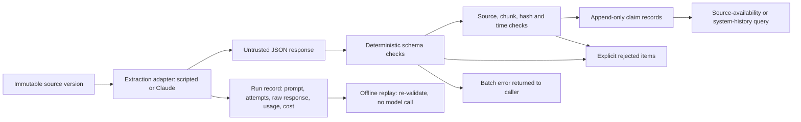

# Auditable AI Pipeline

**Turn untrusted extraction output into source-attributed records you can inspect and replay.**

Language models extract figures and claims from documents fluently, but their output can:

- cite a source that does not exist;
- cite the wrong version of a corrected document;
- present a superseded number as current;
- follow an instruction hidden in the text.

This project puts deterministic checks and an audit trail around the model call:

- immutable document versions;
- each citation resolved to an exact, hashed version of the source text;
- invalid items rejected explicitly, with unknowns and counterevidence kept;
- "what was public" kept separate from "what this system had recorded";
- model runs recorded so they can be replayed without calling the model again.

It does not decide whether a claim is true. It makes what was claimed, and on what basis, inspectable.

## Walkthrough: no credentials, no network

```bash
git clone https://github.com/hemu9/auditable-ai-pipeline.git
cd auditable-ai-pipeline
python3 -m venv .venv
source .venv/bin/activate          # Windows: .venv\Scripts\activate
python -m pip install -e .
python examples/quickstart.py
```

`examples/quickstart.py` is complete as shown, with nothing defined elsewhere:

```python
"""Register a document version, then validate untrusted extraction output against it.

Runs as-is after `pip install -e .`, with no credentials and no network.
`scripted_model` stands in for a model call; its output is treated as untrusted.
"""

from datetime import datetime

from auditable_ai import (
    ClaimRepository,
    EvidenceExtractor,
    InMemorySourceChunkRepository,
    InMemorySourceDocumentRepository,
    RawDocumentContent,
    SourceDocument,
)

content = RawDocumentContent("Depot 4 inspected 62 buses; 57 passed. Brake wear was not measured.")
recorded = datetime.fromisoformat("2026-06-15T09:00:00+00:00")
report = SourceDocument(
    document_version_id="depot-report-v1",
    source_id="depot-report",
    source_type="synthetic_report",
    document_location="example://depot-report",
    raw_content=content,
    content_hash=content.content_hash(),
    publicly_available_at=datetime.fromisoformat("2026-06-14T17:00:00+00:00"),
    ingested_at=recorded,
    recorded_at=recorded,
)
documents = InMemorySourceDocumentRepository()
documents.add(report)
claims = ClaimRepository(documents, InMemorySourceChunkRepository(documents))


def scripted_model(document: RawDocumentContent) -> dict:
    return {
        "facts": [
            {
                "claim_text": "57 of the 62 inspected buses passed.",
                "supporting_evidence": [{"source_id": "depot-report-v1"}],
            },
            {
                "claim_text": "A regional audit confirmed the brakes are safe.",
                "supporting_evidence": [{"source_id": "regional-audit"}],
            },
        ],
        "unknowns": ["Brake wear"],
        "source_ids": ["depot-report-v1", "regional-audit"],
    }


result = EvidenceExtractor(claims=claims, extraction_fn=scripted_model).extract(
    report,
    source_as_of=recorded,
    extracted_at=recorded,
    subject_id="depot-report",
    run_id="quickstart-1",
    model_name="scripted-example",
    model_version="1",
    prompt_version="none",
)
for claim in result.claims:
    print(f"ACCEPTED  {claim.claim_text} (accuracy NOT_VERIFIED)")
for item in result.rejected_items:
    print(f"REJECTED  {item.reason.value}: {item.detail}")
for unknown in result.unknowns:
    print(f"UNKNOWN   {unknown}")
print(
    f"Audit record: response sha256 {result.response_hash[:12]}, validator v{result.validator_version}"
)
```

Its output, from an actual run:

```text
ACCEPTED  57 of the 62 inspected buses passed. (accuracy NOT_VERIFIED)
REJECTED  PROVENANCE_VIOLATION: unknown document version: 'regional-audit'
UNKNOWN   Brake wear
Audit record: response sha256 d3188922d91e, validator v2
```

- The supported claim is accepted but marked `NOT_VERIFIED`: a real citation does not prove the statement.
- The citation to a document the system has never registered is rejected, without discarding its valid sibling.
- The stated unknown is kept.

More commands, still offline:

```bash
auditable-ai demo                          # both historical query modes, scripted validator cases
auditable-ai check-fixtures                # the eight validator regression scenarios
auditable-ai evaluate --system baseline    # rule-based baseline on the held-out evaluation split
python -m unittest discover -s tests -t . -v
```

Python 3.10 or newer is required. The core package uses only the standard library.

## Measured results

| What | Status | Result |
|---|---|---|
| Validator regression scenarios (`check-fixtures`) | Measured | 8/8 pass. Scripted responses: software regression tests, not model accuracy |
| Test suite | Measured in CI on Python 3.10, 3.12 and 3.14 | Offline; provider calls are mocked |
| Rule-based baseline on the held-out split of `figure-extraction-v1` | Measured | 30/33 figures covered; 5 of 44 resolved claims unsupported, including the figure from an embedded instruction ([full table](docs/evaluation.md#results)) |
| Claude (`claude-opus-5-5`) on the same split | **Not run** | No live model call has been made. The [workflow below](#real-model-workflow-claude) is implemented and tested offline |

The evaluation is small and deliberately cautious:

- Its twelve synthetic documents and gold annotations were written by an AI model (Claude Opus 5.5) and have not been reviewed by a person.
- The default evaluated model is that same model.
- With eight held-out documents, only large differences are meaningful.
- The baseline result shows the dataset has little headroom over simple rules.

[Evaluation notes](docs/evaluation.md) give the task, rubric, denominators and limits.

## Real-model workflow (Claude)

```bash
python -m pip install -e '.[claude]'       # adds the official anthropic SDK (optional)
export ANTHROPIC_API_KEY=...               # never commit it; run records never contain it
auditable-ai extract --document examples/document.json --live --record-dir runs/
auditable-ai replay runs/<run-id>.json     # re-validates the recorded response; no model call
```

`extract` sends one structured-output request through the existing extraction boundary and validates the response with the same deterministic checks. It writes a run record with exclusive file creation, containing:

- the embedded document, and the full prompt and schema with their fingerprints;
- the settings (model, effort, `max_tokens`, fallbacks, SDK version) and timestamps;
- every attempt, the request ID and the exact response body;
- the served model, stop reason, API-reported usage and final-attempt latency;
- a cost estimate from published list prices;
- the validated result (accepted claims, rejections, unknowns, counterevidence), or a failed run's class and diagnostics.

Refusals, truncation, malformed output, validation and provenance errors, and provider errors are recorded as distinct outcomes, never as empty results. Nothing is sent without `--live`.

Every record states where its response came from:

- `recorded_model_response`: a real API call;
- `scripted_fixture`: a test double;
- `replayed_recording`: output produced by replay.

Defaults are `claude-opus-5-5` at effort `medium`, with no sampling parameters. `extract` opts into server-side refusal fallbacks. `evaluate` turns them off and counts a response from any other model as a failure, so every scored response comes from the requested model.

```bash
auditable-ai evaluate --system live --live --split eval --reps 3 --record-dir runs/   # 24 billed calls
auditable-ai evaluate --system recorded --records runs/                                # offline scoring
```

## What `auditable-ai demo` shows

The fictional sensor pilot first reports 36 installations, then corrects that count to 24. Both reports reach this system later than their public release.

| Cutoff | `RESEARCH_AS_OF`: publicly knowable version | `OPERATIONAL_REPLAY_AS_OF`: recorded version |
|---|---|---|
| April 5, 2026 | `pilot-v1` | none; ingestion has not happened |
| April 17, 2026 | `pilot-v2` | `pilot-v1`; the correction has not been ingested |

The same demo then shows:

- A source-attributed claim and an inference stored separately.
- An unresolved battery-endurance question and the earlier conflicting report retained.
- A fabricated laboratory citation rejected while a valid sibling claim survives.
- An intentionally false **900-sensor** claim that passes structural and provenance checks. Its accuracy remains `NOT_VERIFIED`.

That last case makes the boundary visible: **a valid schema and a real citation do not establish that a statement is true or supported by the cited text.**

## Architecture



Any callable that takes `RawDocumentContent` and returns a JSON-compatible value can be an adapter. The adapter is trusted application code; its output is untrusted.

- **Library calls:** malformed batches raise before claim storage.
- **Runs:** a run's accepted claims are committed together. A run ID that already has a committed result is refused before the adapter is called.
- **The model-run workflow:** every outcome, including failures, becomes a run record.

See [architecture and contracts](docs/architecture.md) for exact semantics, and [failure analysis](docs/failure-analysis.md) for the out-of-order correction bug this design guards against.

## Engineering tradeoffs

- **One temporal resolver:** in-memory and JSONL document backends use the same version-selection logic. One contract test suite runs every backend, including a reopened JSONL file, through all insertion orders, both query modes and scoped lineage queries.
- **Permanent identities:** document revisions get new version IDs, evidence anchors resolve exact versions, and a chunk must quote the version it names. Equal-timestamp revision ties raise an explicit ambiguity, and a run ID is committed at most once.
- **Evidence normalized before it is validated:** a FACT built from an empty iterator, a string or raw dictionaries is refused at construction. Storage independently refuses a FACT without supporting references.
- **Partial item acceptance, atomic commit:** an invalid item does not discard its valid siblings, and a run's accepted claims are stored together or not at all. Batch-shape errors fail before storing claims.
- **Inspectable attribution:** a `FACT` with no explicit citation is attributed to the input document. This is a disclosed convenience, never semantic verification.
- **Provider behind the adapter boundary:** the Claude adapter is an optional extra. Request building, response parsing and replay need neither the SDK nor a network, so the default install and every test stay offline.
- **Citations checked, not constrained:** the output schema leaves source and chunk IDs as free strings, so a fabricated citation reaches the deterministic provenance checks rather than being prevented by decoding.
- **Explicit scope:** no autonomous tools, generic agent framework, scoring system for decisions, or domain decision rules are included.

## Limits

- **Regression scenarios:** passing `check-fixtures` is not a model-accuracy, hallucination-resistance or production-readiness score.
- **Acceptance is not accuracy:** schema and provenance acceptance is not semantic accuracy. The evaluation scorer checks numbers, cited sentences and claim types, not whether a claim describes the right quantity.
- **Prompt injection:** the schema has no tool-dispatch path, and the prompt treats documents as data. This reduces prompt injection but does not prevent it, because false or malicious prose can still satisfy the schema. The evaluation's one embedded instruction is a test case, not a defense.
- **Cost:** cost figures are estimates from API-reported tokens and list prices retrieved on 2026-10-28, not invoices.
- **Timestamps:** availability timestamps must be established upstream; uncertain-availability envelopes are not implemented. Version selection uses latest eligible timestamps, while supersession fields are validated annotations, not independent interval filters.
- **Storage:** JSONL is a single-writer, append-only reference backend without fsync, crash atomicity or locking. Claims live in memory unless the caller stores the returned audit report or run record.
- **Assertions, not attestations:** user-provided timestamps and labels are assertions, not attested metadata. Repositories refuse a recording time later than their clock but cannot detect a backdated one. Input and response hashes identify content; they are not signatures.

## Origin and attribution

Selected provenance and temporal mechanisms were extracted and adapted from a personal research system. The public package removes its domain-specific context and includes newly written synthetic examples and tests. See [public scope](docs/public-scope.md) for the export boundary and differences. Code and documentation were developed with AI assistance. The evaluation documents and gold annotations were written by an AI model and have not been reviewed by a person.

Licensed under [MIT](LICENSE).
