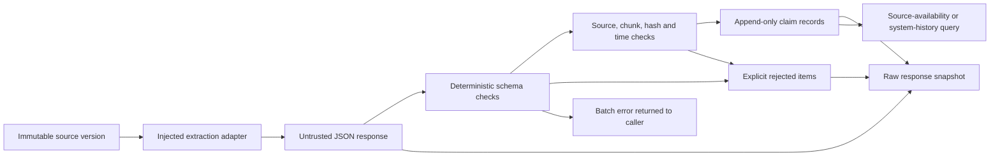

# Auditable AI Pipeline

**Turn untrusted extraction output into source-attributed records you can inspect and replay.**

A small Python engineering project demonstrating deterministic validation around an AI adapter: immutable document versions, explicit rejected items, preserved uncertainty and counterevidence, and two distinct historical query modes.

The included walkthrough uses **synthetic documents and scripted responses**. It needs no credentials, makes no network calls, and does not measure an LLM's accuracy. Runtime dependencies: Python's standard library only.

## Run it

```bash
git clone https://github.com/hemu9/auditable-ai-pipeline.git
cd auditable-ai-pipeline
python3 -m venv .venv
source .venv/bin/activate
python -m pip install -e .
auditable-ai demo
auditable-ai check-fixtures
python -m unittest discover -s tests -t . -v
```

Python 3.10 or newer is required. Build/install tooling uses setuptools. On Windows, activate with `.venv\Scripts\activate`.

To run directly from a checkout without installing, use `PYTHONPATH=src python3 -m auditable_ai demo` on macOS/Linux.

To keep a JSON audit report:

```bash
mkdir -p reports
auditable-ai demo --output reports/demo-001.json
```

Reports contain the raw response, accepted claims, rejected items, unknowns, counterevidence, input/response hashes, declared model/prompt versions, source cutoff, recording time and adapter latency. An existing report path is refused rather than overwritten. The raw response is retained as **untrusted data**.

## What the walkthrough demonstrates

The fictional sensor pilot first reports 36 installations, then corrects that count to 24. Both reports reach this system later than their public release.

| Cutoff | `RESEARCH_AS_OF` — publicly knowable version | `OPERATIONAL_REPLAY_AS_OF` — recorded version |
|---|---|---|
| April 5, 2026 | `pilot-v1` | none — ingestion has not happened |
| April 17, 2026 | `pilot-v2` | `pilot-v1` — correction has not been ingested |

The same demo then shows:

- A source-attributed claim and an inference stored separately.
- An unresolved battery-endurance question and the earlier conflicting report retained.
- A fabricated laboratory citation rejected while a valid sibling claim survives.
- An intentionally false **900-sensor** claim that passes structural and provenance checks. Its accuracy remains `NOT_VERIFIED`.

That last case makes the boundary visible: **a valid schema and a real citation do not establish that a statement is true or supported by the cited text.**

## Architecture



Completed extraction batches return a snapshot containing accepted and rejected items. Malformed batches raise an exception before claim storage; this version does not persist a separate failed-run ledger. See [architecture and contracts](docs/architecture.md) for exact semantics and [failure analysis](docs/failure-analysis.md) for the out-of-order correction bug this design guards against.

## Connect an extraction adapter

The library accepts a callable that takes `RawDocumentContent` and returns a JSON-compatible value. It can call a model, replay a recorded response, or be a deterministic test double. The adapter is **trusted application code**; its output is untrusted.

```python
from auditable_ai import EvidenceExtractor

# `claims` is a ClaimRepository backed by registered source documents/chunks.
# `document` is an exact SourceDocument version already in that repository.
extractor = EvidenceExtractor(
    claims=claims,
    extraction_fn=lambda content: {
        "facts": [
            {
                "claim_text": "The corrected report states that 24 sensors were installed.",
                "supporting_evidence": [{"source_id": document.document_version_id}],
            }
        ],
        "inferences": [],
        "unknowns": ["Battery endurance has not been measured."],
        "contradicting_evidence": [],
        "source_ids": [document.document_version_id],
        "confidence": None,
    },
)
```

This fragment illustrates the adapter boundary; the [runnable scenario builder](src/auditable_ai/scenarios.py) supplies repositories, timestamps, run identity and the `extract()` call. The initial release includes no provider integration or live-model benchmark.

## Engineering tradeoffs

- **One temporal resolver:** in-memory and JSONL document backends use the same version-selection logic. Tests permute insertion order and check reopened storage.
- **Permanent identities:** document revisions get new version IDs; evidence anchors resolve exact versions. Equal-timestamp revision ties raise an explicit ambiguity.
- **Partial item acceptance:** an invalid item does not discard its valid siblings. Batch-shape errors fail before storing claims.
- **Inspectable attribution:** a `FACT` with no explicit citation is attributed to the input document. This is a disclosed convenience, never semantic verification.
- **Explicit scope:** no autonomous tools, generic agent framework, scoring system, or domain decision rules are included.

## Limits and evaluation

`check-fixtures` runs eight scripted validator regression scenarios. Passing those scenarios is **not a model-accuracy, hallucination-resistance or production-readiness score**. [Evaluation notes](docs/evaluation.md) separate current checks from the work needed to measure an actual model.

Availability timestamps must be established upstream; uncertain-availability envelopes are not implemented. Version selection uses latest eligible timestamps, while supersession fields are validated annotations, not independent interval filters. JSONL is a single-writer reference backend without crash atomicity or locking. Claims live in memory unless the caller stores the returned audit report. User-provided timestamps and model/prompt labels are assertions, not attested provider metadata. Input and response hashes identify content; they are not signatures.

## Origin and attribution

Selected provenance and temporal mechanisms were extracted and adapted from a personal research system. The public package removes its domain-specific context and includes newly written synthetic examples and tests. See [public scope](docs/public-scope.md) for the export boundary and differences. Code and documentation were developed with AI assistance.

Licensed under [MIT](LICENSE).
